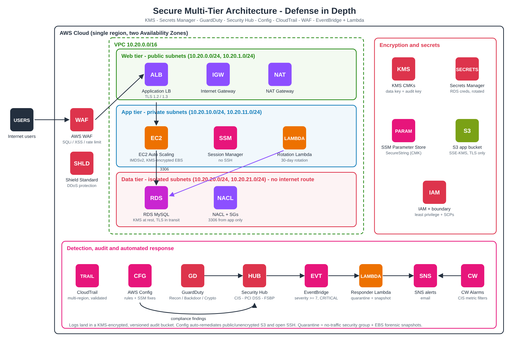

# AWS Defense-in-Depth: Secure Three-Tier Architecture

Security-first reference architecture for a web / app / data application on AWS, deployed with CloudFormation.
It demonstrates encryption at rest and in transit, centralized secrets, automated threat detection, continuous compliance
auditing and automated incident response. It maps to the **Security domain of SAA-C03** and the
**AWS Well-Architected Security Pillar**.



*(Editable source: `architecture.svg`, generated by `docs/diagram/generate_diagram.py`.)*

## What it builds

| Layer | Services | Highlights |
|---|---|---|
| Edge | AWS WAF, Shield Standard, ALB | Managed rules for SQLi, XSS/common exploits, bad inputs, IP reputation; rate limit; TLS 1.2/1.3 |
| Network | VPC, subnets, SGs, NACL, S3 gateway endpoint | Public / private / isolated tiers; data tier has no internet route; SG-to-SG rules; VPC flow logs |
| Compute | EC2 Auto Scaling | IMDSv2 only, KMS-encrypted EBS, Session Manager instead of SSH, permission-bounded role |
| Data | RDS MySQL, S3 | KMS encryption, TLS enforced, no public access |
| Keys and secrets | KMS, Secrets Manager, SSM Parameter Store | Two CMKs with rotation; grant conditions; RDS password rotated every 30 days by Lambda |
| Detection | GuardDuty, Security Hub, CloudTrail, CloudWatch | CIS 1.4 / PCI DSS 3.2.1 / FSBP scores; multi-region validated trail; CIS metric-filter alarms |
| Compliance | AWS Config + SSM Automation | Auto-remediation of public or unencrypted S3 and world-open SSH |
| Response | EventBridge, Lambda, SNS | Severity >= 7 GuardDuty findings quarantine the instance, snapshot its disks and email you |
| Governance | IAM permission boundary, SCPs | Deny root usage, protect security services, require encryption, restrict regions |

## Repository layout

```
cloudformation/   8 stacks, deployed in numeric order by scripts/deploy.sh
lambda/           incident-response function
policies/         Service Control Policies (apply in the Organizations management account)
scripts/          deploy, cleanup, apply-scps, test-incident-response
docs/             architecture, design decisions, Well-Architected mapping, testing, diagram
```

## Deploy

Prerequisites: AWS CLI v2 with admin credentials in a **sandbox account**, Python 3.

```bash
export AWS_REGION=eu-west-1
export ALERT_EMAIL=you@example.com
export CERTIFICATE_ARN=arn:aws:acm:...    # recommended; empty = HTTP only (lab use)
./scripts/deploy.sh
```

Confirm the SNS subscription e-mail, then follow [docs/testing.md](docs/testing.md).
Apply SCPs separately with `./scripts/apply-scps.sh <ou-id>` (needs AWS Organizations).

## Cost and cleanup

NAT Gateway, ALB, RDS, GuardDuty, Config, Security Hub and WAF bill continuously. Run `./scripts/cleanup.sh` when done;
KMS keys stay in a 7-day pending-deletion window.

## Known limits

- One NAT gateway and single-AZ RDS by default (cost). Set `MultiAz=true` and add a NAT per AZ for production.
- Security Hub and Config fail to create if already enabled in the account and region.
- Unencrypted EBS and RDS cannot be fixed in place, so those Config rules are detective only.
- Single account and region; see `docs/design-decisions.md` for the multi-account path.

## License

MIT
